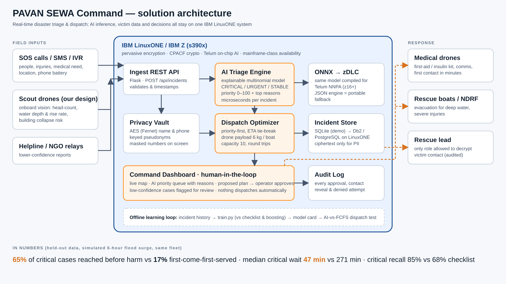

# PAVAN SEWA Command
**Real-time AI triage & dispatch for flood disasters, built for IBM LinuxONE / IBM Z.**
*IBM Z Datathon 2026 · Team techies.4 · SRM Institute of Science and Technology, Tiruchirappalli*



## The problem
During a flood, control rooms get hundreds of SOS calls, drone sightings and helpline relays per hour. Today they are mostly handled **first-come-first-served** or with a paper checklist. A family on a collapsing roof with rising water can wait behind dozens of stable reports, and by the time a boat reaches them the window has closed. At the same time, the system is collecting sensitive victim data (names, phone numbers, medical conditions) under chaotic conditions.

## What PAVAN SEWA Command does
1. **Ingests** incidents from SOS calls, our PAVAN SEWA scout drones (head-count, water depth, rise rate, collapse risk) and helpline relays through one REST API.
2. **Triage AI** classifies every incident as CRITICAL / URGENT / STABLE, gives it a 0–100 priority and **explains why** (top factors), in microseconds.
3. **Dispatch optimizer** proposes which medical drone (6 kg kit) or rescue boat (capacity 10) should go where, using priority first and ETA second.
4. **Human-in-the-loop:** an operator approves dispatches. Low-confidence predictions are flagged for review. Nothing goes out automatically.
5. **Privacy by design:** names and phone numbers are stored only as AES ciphertext. Operators see a pseudonym and a masked number. Only the *rescue-lead* role can decrypt, and every reveal (or denied attempt) is audited.

## Results (held-out test data, `model/metrics.json`, `model/dispatch_eval.json`)
| Triage approach | Accuracy | Macro-F1 | Critical recall |
|---|---|---|---|
| Rule checklist (today) | 61.8% | 59.0% | 68.0% |
| **Explainable logistic model (deployed)** | **83.2%** | **81.6%** | **85.0%** |
| Gradient boosting (benchmark) | 80.7% | 77.1% | 71.9% |

Dispatch simulation: 300 held-out incidents in a 6-hour surge, same fleet (9 drones + 9 boats, 3 bases), 10 runs:

| | AI priority dispatch | First-come-first-served |
|---|---|---|
| Critical cases reached before harm | **65.3%** | 16.9% |
| Median wait, critical case | **47 min** | 271 min |
| Urgent cases reached before harm | 51.3% | 50.7% |

> **Honest note:** the data is synthetic. It comes from a generator modelled on the Cauvery / Kollidam flood zone around Tiruchirappalli (`data/generate.py`), and the ground-truth formula is hidden from the model. The pipeline is built to be retrained on real NDMA / state control-room logs.

## Measured on IBM LinuxONE (s390x)
LinuxONE Community Cloud VM · RHEL 9 · Python 3.9 (`model/benchmark_s390x.txt`)

| Metric | Result |
|---|---|
| Triage latency p50 / p99 | **17.6 µs / 30.3 µs** |
| Throughput, 1 core | **54,172 incidents/s** |
| Dispatch plan for 150 open incidents | **2.8 ms** |
| AES field encryption | 48 µs per field |

## Why IBM Z / LinuxONE
* **AI next to the data:** inference runs in-process on the same system that stores the incidents. No external AI API, no data leaving the platform, and latency measured in microseconds (`scripts/benchmark.py`).
* **Telum on-chip AI path:** the model is exported to core-op ONNX (`scripts/export_onnx.py`: MatMul / Add / Softmax) so it can be compiled with the **IBM Z Deep Learning Compiler** (`--maccel=NNPA`) for the Integrated Accelerator for AI on z16 and later.
* **Security:** AES field encryption runs on CPACF crypto hardware via OpenSSL, on top of pervasive encryption. The architecture is ready for Secure Execution / Hyper Protect.
* **Availability:** a disaster command centre cannot go down in the middle of a disaster, which is exactly the workload mainframe-class reliability is built for.
* **Scale-up:** one LinuxONE system can serve every district control room in a state from a single secure data store (SQLite in the demo, Db2 / PostgreSQL on LinuxONE in production).

## Run it
```bash
# any Linux / macOS (dev)
pip install -r requirements.txt   # just Flask + cryptography
python app.py                      # http://localhost:8080 -> "Start flood surge simulation"

# IBM LinuxONE (s390x) VM
bash deploy/setup_linuxone.sh      # installs Flask + cryptography, re-runs evaluation + benchmark on s390x
python3 app.py
# from your laptop if port 8080 is closed:
ssh -i key.pem -L 8080:localhost:8080 linux1@<VM-IP>
```
Container (multi-arch, builds natively on s390x): `podman build -f deploy/Dockerfile -t pavan-sewa-command .`

Re-run the science (needs `pip install -r requirements-train.txt`): `python data/generate.py && python model/train.py && python scripts/evaluate_dispatch.py && python -m pytest -q tests`

## API
| Method | Path | Purpose |
|---|---|---|
| GET | `/api/health` | platform (shows `s390x` on IBM Z), model version |
| POST | `/api/incidents` | ingest one incident → triage + priority + reasons |
| GET | `/api/incidents?status=open` | priority queue (no plaintext PII) |
| GET | `/api/plan` | proposed dispatch plan |
| POST | `/api/approve` | operator approves dispatches (audited) |
| POST | `/api/reveal` | decrypt contact (`rescue-lead` only, audited) |
| GET | `/api/stats`, `/api/audit`, `/api/fleet` | KPIs, audit log, resources |
| POST | `/api/simulate` | start/stop a live flood-surge replay |

## Repository layout
```
app.py                 Flask API + dashboard server
engine/                features, triage (pure-Python inference), dispatch, privacy vault, store
model/                 train.py, triage_model.json/.onnx, metrics.json, dispatch_eval.json
data/                  generate.py + incidents.csv (synthetic)
scripts/               evaluate_dispatch.py, benchmark.py, export_onnx.py
static/index.html      command dashboard (no external CDN; works on an isolated network)
deploy/                LinuxONE setup script, Dockerfile, systemd unit
docs/                  architecture diagram
tests/                 unit tests
```

## Responsible AI
Transparent model with per-incident reasons · class-balanced training so critical cases aren't under-detected · human approval for every dispatch · low-confidence flag · PII encryption, role-based reveal, append-only audit log · synthetic data only, no real victims' data.

## Open-source used
Python, Flask, NumPy, pandas, scikit-learn, cryptography (Fernet), SQLite, ONNX / ONNX Runtime (export check), Playwright (demo recording). All licensed under BSD, MIT, Apache-2.0 or PSF terms.

## License
MIT
